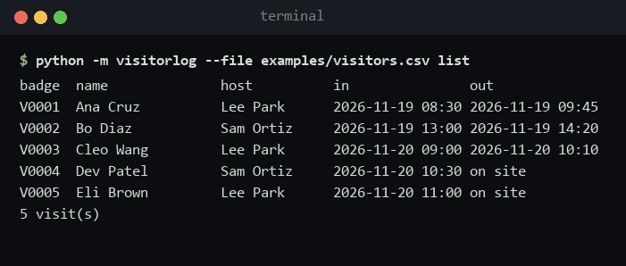

<p align="center"></p>

# visitor-log-cli

A front desk visitor log you run from the command line. Sign visitors in and out, see who is on site right now, and export a date range to CSV or JSON with minutes on site. Everything is stored in one plain CSV file, so you can open it in a spreadsheet at any time.



## What it is for

Front desks and building security teams need a simple record of who came, who they visited and how long they stayed, and a quick answer to "who is still in the building?" This tool covers that with no database and no server. Receptionists, facility coordinators and security staff can use it on any computer with Python.

## Install

```
git clone https://github.com/yassine2med/visitor-log-cli
cd visitor-log-cli && pip install -r requirements.txt
```

## How to use

| I want to | Command |
|---|---|
| Sign a visitor in (prints the badge number) | `PYTHONPATH=src python -m visitorlog checkin "Ana Cruz" --company "Northside HVAC" --host "Lee Park" --purpose "Service"` |
| Sign out by badge number or part of the name | `PYTHONPATH=src python -m visitorlog checkout V0001` |
| See who is on site now | `PYTHONPATH=src python -m visitorlog list --on-site` |
| List one day | `PYTHONPATH=src python -m visitorlog list --date 2026-11-20` |
| Export a date range as CSV or JSON | `PYTHONPATH=src python -m visitorlog export --format json --from 2026-11-19 --to 2026-11-20 --out week.json` |
| Use another log file | add `--file path.csv` before the command |
| Show help | `PYTHONPATH=src python -m visitorlog --help` |

The log is `visitors.csv` in the current folder unless you pass `--file`. Use `--at "2026-11-20 09:15"` on `checkin` and `checkout` to enter a time instead of now.

Exit codes: 0 on success, 1 when the request cannot be done (unknown badge, already checked out, bad date), 2 when the log file cannot be read.

Example with the sample log:

```
PYTHONPATH=src python -m visitorlog --file examples/visitors.csv list --on-site
```

Output:

```
badge  name              host          in               out              
V0004  Dev Patel         Sam Ortiz     2026-11-20 10:30 on site          
V0005  Eli Brown         Lee Park      2026-11-20 11:00 on site          
2 visit(s)
```

Export from the same file:

```
PYTHONPATH=src python -m visitorlog --file examples/visitors.csv export --format csv --from 2026-11-20
```

```
badge,name,company,host,purpose,checked_in,checked_out,minutes
V0003,Cleo Wang,Brightline Fire,Lee Park,Alarm test,2026-11-20 09:00,2026-11-20 10:10,70
V0004,Dev Patel,Acme Supply,Sam Ortiz,Delivery,2026-11-20 10:30,,
V0005,Eli Brown,Greenleaf Cleaning,Lee Park,Contract meeting,2026-11-20 11:00,,
```

Signing in and out:

```
Checked in Ana Cruz: badge V0001 at 2026-11-21 09:00
Checked out Ana Cruz: badge V0001 after 65 minute(s)
```

Run the tests with `python -m pytest -q`.

## How it works

1. Each command loads the CSV, changes the list in memory, and writes the file back.
2. Badges are numbered V0001, V0002 and so on, one higher than the largest in the file.
3. A name that is already on site cannot be signed in twice; a returning visitor gets a new badge.
4. Checkout accepts a badge or a name fragment; if the fragment matches more than one person on site it asks for the badge.
5. Export adds a `minutes` column (empty while the visitor is still on site) and can filter by first and last day.

## Limits

- One CSV file, no locking. Do not run two desks against the same file at once.
- Times are local clock times to the minute, with no time zones.
- No photo, signature or ID capture, and no printing of badges.

## License

MIT. Yassine Emhamed, 2026.
